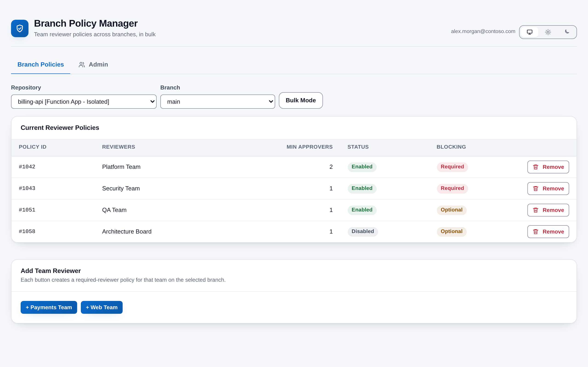
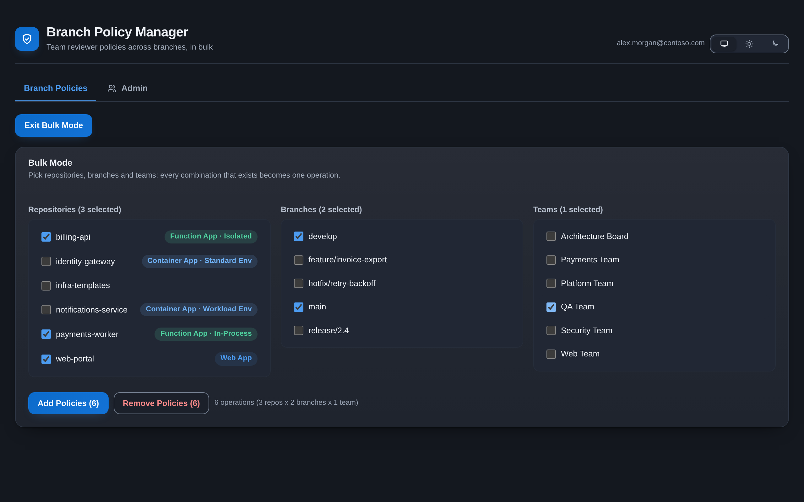
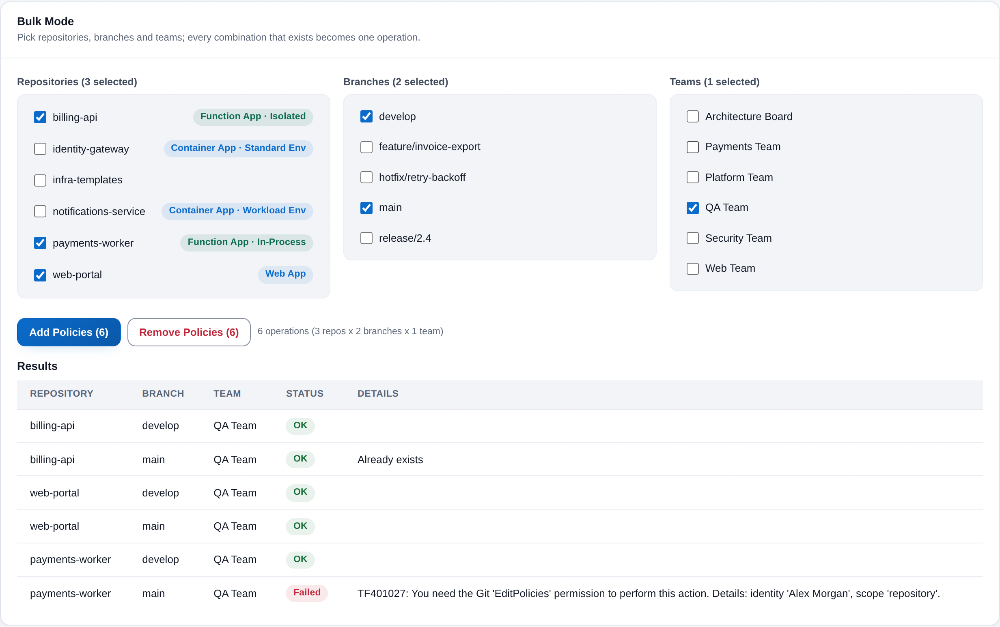
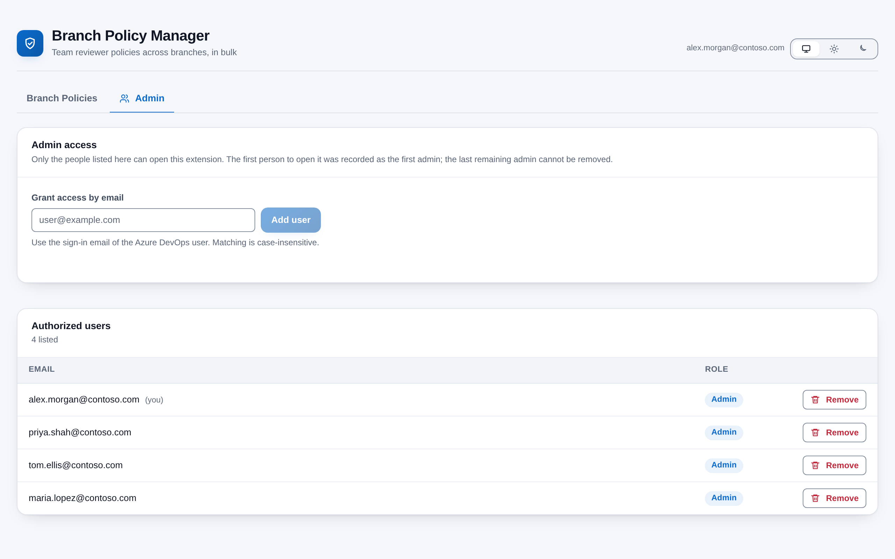

# Branch Policy Manager

[](https://github.com/adam-wheater/azure-devops-branch-policy-manager/actions/workflows/ci.yml)

An Azure DevOps extension for adding and removing **team reviewer approval policies** on branches, one branch at a time or in bulk across many repositories, branches and teams at once. It is built for the people who look after branch protection in a project (repo admins, platform and security teams) and answers one question: *which teams must approve pull requests into this branch, and how do I change that everywhere in one go?* You find it under **Repos > Branch Policies**. Only people on an admin-managed list can open it, and it runs entirely in your browser against your own organization's Azure DevOps REST API.



## Table of contents

- [Getting started](#getting-started)
- [Features](#features)
- [Screens](#screens)
  - [Header and theme](#header-and-theme)
  - [Access gate](#access-gate)
  - [Branch Policies tab](#branch-policies-tab)
  - [Admin tab](#admin-tab)
- [How it works](#how-it-works)
- [Settings](#settings)
- [Detection logic](#detection-logic)
  - [Policy matching](#policy-matching)
  - [Repository classification](#repository-classification)
- [Scopes & permissions](#scopes--permissions)
- [Privacy](#privacy)
- [Troubleshooting and known limitations](#troubleshooting-and-known-limitations)
- [Development](#development)
- [Project structure](#project-structure)
- [Tech stack](#tech-stack)
- [Contributing](#contributing)
- [License](#license)

## Getting started

1. Install **Branch Policy Manager** from the Visual Studio Marketplace (publisher `adam-wheater`): <https://marketplace.visualstudio.com/items?itemName=adam-wheater.branch-policy-manager>. An organization administrator must approve the install.
2. Open any project and go to **Repos**. The hub appears as **Branch Policies** at the end of the Repos hub group (`ms.vss-code-web.code-hub-group`, order 99).
3. **First run:** the first person to open the hub is recorded as the first admin and sees the "You are the first admin" banner. Nobody else can open the extension until that person adds them.
4. Use the **Admin** tab to grant access to colleagues by their Azure DevOps sign-in email.
5. Back on **Branch Policies**, pick a repository and branch, or switch to **Bulk Mode**.

## Features

- **Team approval management** -- Add or remove a *Required reviewers* policy for any project team on any branch (for example `develop` or `main`) from a single screen.
- **Bulk operations** -- Pick any combination of repositories, branches and teams; every combination that exists becomes one operation, and a results table reports each as OK or Failed with the reason.
- **Duplicate-safe** -- Bulk add skips combinations that already have a matching policy ("Already exists"); bulk remove reports "No matching policy found" instead of failing.
- **Admin access control** -- Only users on the authorized list can open the extension; the first person to open it becomes the first admin, admins grant and revoke access by email, and the last remaining admin can never be removed.
- **Confirmation dialogs** -- Every removal and every bulk action goes through an accessible modal (focus trap, Escape to cancel, focus restored afterwards) before anything is sent.
- **Repository classification badges** -- Repositories are scanned in the background and labelled Function App (Isolated / In-Process), Container App (Standard / Workload) or Web App to help pick the right repos in bulk mode.
- **Theme follows Azure DevOps** -- Light, dark and high-contrast host themes are detected from the SDK's `themeApplied` event, with a manual Azure DevOps / Light / Dark override in the header.
- **WCAG AA contrast** -- Every text and control colour pair in the design system is audited to 4.5:1 (text) and 3:1 (UI) in both palettes; high-contrast mode adopts the host's own colours.
- **Error boundary** -- Rendering failures are caught and offer a "Try again" button instead of a blank hub, and an SDK handshake failure renders a plain-text diagnostic.

There is no settings panel, and a bulk operation cannot be cancelled once confirmed (see [Troubleshooting and known limitations](#troubleshooting-and-known-limitations)). The only stored state is the authorized-user list and your theme choice, described under [Settings](#settings).

## Screens

### Header and theme



The header is the shared `AppShell`: brand mark and product name on the left, the signed-in email and the theme toggle (Azure DevOps / Light / Dark) on the right. Below it, two tabs switch between **Branch Policies** and **Admin**. The first-run banner appears only to the user who was just recorded as the first admin (see [Access gate](#access-gate)). The colours follow your Azure DevOps theme, light, dark or high contrast, unless you pin Light or Dark with the toggle; see [Theming](#theming).

### Access gate

Before any tab renders, `App` shows a centred `Gate` card.

| Situation | What you see |
|-----------|--------------|
| Access check in progress | "Checking access" with a busy indicator and the text "Looking up the authorized-user list for this organization." |
| No list exists yet (first run) | The current user is recorded as the first admin, the app opens, and an info banner titled "You are the first admin" explains what happened. The banner is dismissible and is not shown again on later visits. |
| List exists, user is on it | The app opens with the **Branch Policies** tab active. |
| List exists, user is not on it | "Access denied" with an alert icon, the sentence "You do not have permission to use Branch Policy Manager. Contact an administrator of this extension to request access." and "Signed in as *email*". |
| The list cannot be read (network / permission error) | Access denied as above plus an error banner "Could not verify access" with the message. A failed read is never mistaken for a first run. |
| `SDK.getUser()` returns an empty name | Access denied; an empty identity is never recorded as admin. |

### Branch Policies tab

The page first shows a "Loading project data..." card with skeleton rows while the project, repositories and teams load. Errors from any load appear as a dismissible red banner at the top of the page; successful actions appear as a green banner.

#### Single-branch mode

The toolbar holds a **Repository** select (every enabled repository, suffixed with its classification in square brackets once known, for example `payments-api [Function App - Isolated]`), a **Branch** select (disabled until a repository is chosen) and a **Bulk Mode** button. Switching repository clears the branch and policy list synchronously so a stale list is never shown against the new selection.

Until both are chosen, a card shows the empty state "Select a **repository** and **branch** to manage reviewer policies." with the hint "Or switch to **Bulk Mode** to add or remove team approvals across multiple repositories and branches at once."

**Current Reviewer Policies** lists every *Required reviewers* configuration whose scope covers the branch. While loading it shows two skeleton rows; when there are none it shows "No reviewer policies on this branch."

| Column | Definition | Colour / tone |
|--------|------------|---------------|
| Policy ID | `#` + the policy configuration ID, monospace | -- |
| Reviewers | `settings.requiredReviewerIds` mapped to team names via the loaded team list; unknown IDs are shown raw, comma-separated | -- |
| Min Approvers | `settings.minimumApproverCount`, right-aligned; a missing or zero value displays as 1 | -- |
| Status | `isEnabled` | **Enabled** = success (green) pill, **Disabled** = neutral (grey) pill |
| Blocking | `isBlocking` | **Required** = danger (red) pill, **Optional** = warn (amber) pill |
| Actions | Remove button (danger, trash icon), disabled while any action is running. A policy that also covers other branches or repositories (project-wide, prefix, or several scopes) shows a muted **Shared** label instead: removing it would remove it everywhere, so change it in Project settings | -- |

Remove opens a confirmation modal "Remove reviewer policy" / "Remove this reviewer policy?" with a red **Remove** button. On success the list is re-read and a green banner says "Policy removed".

**Add Team Reviewer** appears only when at least one team has no policy on the branch. It shows one primary button per such team (`+ Team name`); clicking one creates the policy immediately (no confirmation, since adding a required reviewer is not destructive), reloads the list and shows "Added reviewer policy for "Team name"". Teams already covered are excluded by comparing their ID against every `requiredReviewerIds` entry in the current list.

#### Bulk mode



**Bulk Mode** replaces the two selects with a single **Bulk Mode** card ("Pick repositories, branches and teams; every combination that exists becomes one operation.") containing three checkbox pickers in a three-column grid. Toggling bulk mode on or off clears all bulk selections and any previous results.

| Picker | Contents | Empty / loading text |
|--------|----------|----------------------|
| Repositories (*n* selected) | Every enabled repository with its classification badge; "scanning..." in italics while classification is still running for that repo | -- |
| Branches (*n* selected) | The union of branch refs across the selected repositories, de-duplicated by ref and sorted by name, loaded on demand per repository | "Select at least one repository to see branches." / "Loading branches..." / "No branches found." |
| Teams (*n* selected) | Every team in the project | -- |

Classification badge tones: **Function App · Isolated / In-Process** = elite (deep green), **Container App · Standard Env / Workload Env** = info (blue), **Web App** = accent. Repositories that match nothing get no badge.

Below the pickers sit **Add Policies (*n*)** (primary) and **Remove Policies (*n*)** (danger). *n* is the operation count: for each selected repository, each selected branch **that exists in that repository**, times the number of selected teams. A caption restates it as "*n* operations (*r* repos x *b* branches x *t* teams)". Both buttons are disabled while an action runs or when the count is zero.

Either button opens a confirmation modal: "Add policies in bulk" / "Add *n* reviewer policy/policies across *r* repo(s)?" with an **Add *n*** button, or "Remove policies in bulk" / "Remove *n* reviewer policy/policies across *r* repo(s)?" with a red **Remove *n*** button. After confirmation a progress bar labelled "Processing *i* of *n*..." tracks the batch, and a **Results** table appears:

| Column | Content | Tone |
|--------|---------|------|
| Repository / Branch / Team | The operation's names | -- |
| Status | **OK** or **Failed** | OK = success pill, Failed = danger pill |
| Details | The error message for failures; for successes, "Already exists" (bulk add) or "No matching policy found" (bulk remove) in muted text when applicable, otherwise blank. Bulk remove never deletes a shared policy: that row fails with "Not removed: #*id* also covers other branches or repositories" | -- |

Afterwards a red banner reports "*f* of *n* operations failed" if any failed, a green banner reports "*s* policies added/removed successfully" if any succeeded, and the single-branch view (if a repository and branch were selected) is refreshed.

### Admin tab



Two cards. **Admin access** ("Only the people listed here can open this extension. The first person to open it was recorded as the first admin; the last remaining admin cannot be removed.") holds a labelled email input and an **Add user** button. The button is disabled until the input is non-blank; Enter submits. An address without an `@` is rejected client-side with "Please enter a valid email address" and never reaches the service. Addresses are lower-cased and trimmed before storage; adding an address that is already listed is a no-op.

**Authorized users** (hint "*n* listed") shows skeleton rows while loading, the empty state "No authorized users yet" / "Add an email address above to grant access." when the list is empty, otherwise a table:

| Column | Content |
|--------|---------|
| Email | The stored address, followed by "(you)" for the signed-in user |
| Role | An accent pill reading **Admin** (every listed user is an admin) |
| Actions | Remove (danger, trash icon). Disabled, with the tooltip "The last remaining admin cannot be removed", when only one address is listed |

Remove opens the confirmation modal "Remove access". Removing someone else asks "Remove access for *email*?"; removing yourself asks "Remove your own access (*email*)? You will lose access to this extension as soon as you reload it." The service independently refuses to remove the last address ("Cannot remove the last admin"), so the guard holds even if two admins race.

## How it works

```
+------------------+      +------------------------+      +------------------------+
|  Hub loads       | ---> |  AdminService          | ---> |  Extension Data        |
|  SDK.init()      |      |  resolveAccess(email)  |      |  Service               |
|  SDK.ready()     |      |  getDocument /         |      |  BranchPolicyManager-  |
|  SDK.getUser()   |      |  createDocument        |      |  Settings/admin-settings|
+------------------+      +------------------------+      +------------------------+
                                     |  authorized
                                     v
                          +------------------------+      +------------------------+
                          |  IdentityService       | ---> |  CoreRestClient.getTeams|
                          |  project, repos,       |      |  GitRestClient          |
                          |  teams, branches       |      |   .getRepositories      |
                          +------------------------+      |   .getRefs("heads/")    |
                                     |                    +------------------------+
                                     v
                          +------------------------+      +------------------------+
                          |  PolicyService         | ---> |  PolicyRestClient       |
                          |  list / add / remove   |      |   .getPolicyTypes       |
                          |  single or bulk        |      |   .getPolicyConfigurations
                          +------------------------+      |   .createPolicyConfiguration
                                     |                    |   .deletePolicyConfiguration
                                     v                    +------------------------+
                          +------------------------+      +------------------------+
                          |  RepoClassification-   | ---> |  GitRestClient          |
                          |  Service (4 workers)   |      |   .getItems (recursive) |
                          +------------------------+      |   .getItemText          |
                                                          +------------------------+
```

1. **SDK init.** `BranchPolicyHub.tsx` calls `SDK.init()` then `SDK.ready()`, mounts `<ThemeProvider><App/></ThemeProvider>` and imports `styles/app.css`. If the handshake rejects, a plain-DOM message and the error text are written into `#root` instead.
2. **Identity.** `IdentityService.getCurrentUserEmail()` returns `SDK.getUser().name`, the signed-in user's email. No Profile REST call is made.
3. **Access check.** `AdminService.resolveAccess(email)` reads the document `admin-settings` from the Extension Data Service collection `BranchPolicyManagerSettings` using `getDocument(..., { defaultValue: null })`, so a missing document is distinguishable from a failed request. If no document exists the current user is written as the first admin with `createDocument` (which fails if someone else created it first, in which case the list is re-read). Otherwise access is granted only if the normalised (lower-cased, trimmed) email is on the list.
4. **Project context.** `PolicyPage` resolves the current project through `IProjectPageService.getProject()` and loads, in parallel, `GitRestClient.getRepositories(project)` (disabled repositories dropped, sorted by name) and `CoreRestClient.getTeams(project, false, 100, skip)` paged 100 at a time until a short page is returned.
5. **Branches and policies.** Selecting a repository calls `GitRestClient.getRefs(repoId, undefined, "heads/")`. Selecting a branch calls `PolicyService.getReviewerPoliciesForBranch`, which resolves the *Required reviewers* policy type ID once per session via `PolicyRestClient.getPolicyTypes` (matching `displayName` containing "required reviewer", falling back to the well-known ID `fd2167ab-b0be-447a-8571-0d4ce8d5dbe1`), fetches `getPolicyConfigurations(project)` and keeps configurations of that type with a scope entry that covers the branch: `repositoryId` is the repository or `null` (every repository), and `refName` equals the branch ref, is a `Prefix` the branch ref starts with, or is `null`.
6. **Writes.** `addReviewerPolicy` calls `createPolicyConfiguration` with `isEnabled: true`, `isBlocking: true`, `minimumApproverCount: 1`, `creatorVoteCounts: false`, `allowDownvotes: false`, `resetOnSourcePush: false` and one `Exact` scope on the repository and branch ref. `removeReviewerPolicy` calls `deletePolicyConfiguration(project, policyId)`.
7. **Bulk.** `bulkAddPolicies` and `bulkRemovePolicies` iterate the operations **sequentially**, calling `onProgress(current, total)` before each one. Add re-reads the branch's policies to skip duplicates; remove deletes every matching policy for the team. One failed operation is recorded and the batch continues. There is no cancellation token: once confirmed, a batch runs to the end.
8. **Classification.** After repositories load, `classifyRepos` runs four workers over the repo list. Each worker calls `getItems(repoId, project, "/", Full, ...)` for the whole tree, then `getItemText` on every `.csproj` and every `.yml`/`.yaml`. Results live in component state only; nothing is persisted and the scan repeats on every page load.
9. **Persistence.** The only stored data is the `admin-settings` document in collection `BranchPolicyManagerSettings`, written at the default (collection-wide) scope so one list covers every project in the organization; and the theme choice, kept in the browser under the `localStorage` key `branch-policy-manager.theme`.

## Settings

There is no settings panel. The two pieces of persisted state are:

| Setting | Default | Values / validation | Effect | Stored where |
|---------|---------|---------------------|--------|--------------|
| Authorized users | Empty until the first person opens the hub, who is then recorded | Any string containing `@`; lower-cased and trimmed; duplicates ignored; the list may never become empty | Decides who passes the access gate and who can edit the list | Extension Data Service, collection `BranchPolicyManagerSettings`, document `admin-settings`, default (collection) scope, so shared by every project in the organization |
| Theme mode | `ado` (follow the Azure DevOps theme) | `light` or `dark` when set; any other stored value is treated as `ado` | Forces the light or dark palette; ignored while a high-contrast theme is active | Browser `localStorage`, key `branch-policy-manager.theme`; if storage is blocked the choice simply does not persist |

Policy creation parameters (`isBlocking: true`, `minimumApproverCount: 1`) are fixed in code and not user-configurable.

## Detection logic

### Policy matching

| Rule | Condition | Tuning |
|------|-----------|--------|
| Policy type | Configuration `type.id` equals the resolved *Required reviewers* type ID (from `getPolicyTypes`, else the well-known fallback) | Not configurable; result cached for the browser session |
| Covers this branch | One scope entry has `repositoryId` = the selected repo or `null`, and a `refName` that equals the branch ref, is a `Prefix` of it, or is `null` (a `null` ref counts as every branch, including a default-branch scope) | Not configurable |
| Team already covered | The team ID appears in the policy's `requiredReviewerIds` | Not configurable |

### Repository classification

Classification is best-effort and purely informational; it never blocks an action. Matching is case-insensitive substring matching on file contents, in this order, and stops at the first hit.

| Classification | Trigger | Sub-type |
|----------------|---------|----------|
| Function App | Any `.csproj` containing `Microsoft.NET.Sdk.Functions`, `Microsoft.Azure.Functions.Worker`, `Microsoft.Azure.WebJobs` or `Microsoft.Azure.Functions.Extensions` | **Isolated** if the file contains `Microsoft.Azure.Functions.Worker` (or `.Worker.Sdk`) or `<OutputType>Exe</OutputType>`; otherwise **In-Process** if it contains `Microsoft.NET.Sdk.Functions` or `Microsoft.Azure.WebJobs`; otherwise unknown |
| Container App | Any `.yml`/`.yaml` containing `containerapp`, `container-app`, `azurecontainerapps`, `managedenvironment`, `containerenvironmentname`, `container_environment` or `ctr-environment` | **Workload** if a non-comment line contains `ctr-environment-workload`, `container-environment-workload`, `managedenvironment` together with `-workload`, an environment-name key (`containerEnvironmentName`, `environmentName`, `env_name`, ...) together with `-workload`, a `value:`/`default:` line containing `ctr-environment-workload`, or a container-environment key followed by `-workload`/`_workload` on the same line; otherwise **Standard** |
| Web App | Any `.yml`/`.yaml` (already fetched above) containing `azurewebapp`, `azure-webapp`, `azurermwebappdeployment` or `app-service` | -- |
| Unknown | Nothing matched, the repository is empty, or a read failed | No badge |

None of these rules can be tuned or disabled from the UI; they live in `src/services/RepoClassificationService.ts`.

## Scopes & permissions

| Scope | Why it is requested | Concrete calls |
|-------|---------------------|----------------|
| `vso.code_manage` | Read, create and delete branch policy configurations; read repository contents for classification | `PolicyRestClient.getPolicyTypes`, `getPolicyConfigurations`, `createPolicyConfiguration`, `deletePolicyConfiguration`; `GitRestClient.getRepositories`, `getRefs`, `getItems`, `getItemText` |
| `vso.project` | Resolve the current project and list its teams | `IProjectPageService.getProject`, `CoreRestClient.getTeams` |

The Extension Data Service calls (`getDocument`, `createDocument`, `setDocument`) use the token from `SDK.getAccessToken()`; no `vso.extension.data` scope is declared. All calls go to the Azure DevOps organization the extension is installed in.

## Privacy

Everything runs inside the Azure DevOps web UI, in the extension's iframe, and talks only to the REST API of the organization the extension is installed in. No telemetry is collected and no third-party service is called. The extension stores exactly two things:

- The authorized-user email list, as the `admin-settings` document in the `BranchPolicyManagerSettings` collection of the Azure DevOps Extension Data Service for your organization.
- Your theme choice (`light` or `dark`), in your browser's `localStorage` under `branch-policy-manager.theme`.

Repository contents read for classification are inspected in memory and discarded.

## Troubleshooting and known limitations

| Symptom / limitation | Explanation |
|----------------------|-------------|
| "Access denied" with "Could not verify access" | The Extension Data Service read failed (network, token or permission). The extension deliberately refuses rather than treating the failure as a first run. Reload; if it persists, check that the extension is installed and approved for the organization. |
| Someone unexpected became the first admin | Whoever opens the hub first after installation is recorded. There is no pre-seeded admin; coordinate the first open, or have that person add the intended admins. |
| A user is listed but still denied | The stored address is compared case-insensitively with `SDK.getUser().name`. If the user's sign-in identity differs from the address entered (alias, UPN vs. mail), add the exact sign-in address. |
| Removed yourself and are locked out | By design; another admin must re-add you. The last admin can never be removed. |
| A policy shows Min Approvers 1 but the server has 0 | `minimumApproverCount || 1` maps a missing or zero value to 1 for display. |
| Bulk operations cannot be stopped | Batches run sequentially to completion once confirmed; there is no cancel button or abort signal. Review the operation count in the confirmation before accepting. |
| "Already exists" rows count as OK | Skipping a duplicate is reported as success with the reason in Details, so the "policies added" total includes them. |
| Policy type not recognised on a new tenant | The type ID is resolved by `displayName` containing "required reviewer" and then cached for the session, with the well-known ID as fallback. A renamed or localised type name falls back to the well-known ID. |
| Badges take a long time or never appear | Classification walks the **entire** tree of every repository recursively and downloads every `.csproj` and `.yml`/`.yaml`, four repositories at a time, on every page load. Large or numerous repositories make this slow; it runs in the background and never blocks policy actions. |
| Badge is wrong | Detection is substring matching on file contents (see [Detection logic](#detection-logic)); a stray `app-service` string in any YAML, for example, yields Web App. |
| Teams list seems incomplete | Teams are paged 100 at a time until a short page; repositories and refs are fetched in a single call each, as the REST API returns them. |
| High contrast detected (or not) incorrectly | High contrast is a heuristic on pure black/white primary and secondary text plus `forced-colors`. In that mode the theme toggle is hidden on purpose. |
| Theme choice does not persist | `localStorage` can be blocked inside the extension iframe; the app falls back to following the Azure DevOps theme. |
| `toggleReviewerPolicy` exists but no Enable/Disable button | The service supports enabling or disabling a configuration, but the UI does not expose it. |

## Development

### Prerequisites

- Node.js 20 or later (`engines.node >= 20`) and npm.
- Install with `npm ci --legacy-peer-deps` (or `npm install --legacy-peer-deps`). The flag is required because of the Azure DevOps SDK and React 18 peer ranges, and CI uses it too.

### npm scripts

| Script | What it does |
|--------|--------------|
| `npm run build` | Production webpack build into `dist/`; `postbuild` runs `scripts/verify-bundle.js`, then `scripts/third-party-notices.js`. |
| `npm run build:dev` | Development build with source maps (CSS is still extracted so the hand-written stylesheet link is exercised) |
| `npm run screenshots` | Builds the hub on sample data and saves the screenshots to `static/screenshots/` (see below). |
| `npm run verify:bundle` | Run the `dist/` sanity check on its own |
| `npm run package` | `tfx extension create` -> `out/*.vsix` |
| `npm test` | Jest, both projects, verbose |
| `npm run test:watch` | Jest in watch mode |
| `npm run lint` / `npm run lint:fix` | ESLint over `src/` and `tests/` (flat config, Prettier-compatible) |
| `npm run format` / `npm run format:check` | Prettier write / check over `src/` and `tests/` |
| `npm run publish:marketplace` | `tfx extension publish` with the manifest |

### Run it locally with sample data

`demo/` builds the real hub against stand-ins for the Azure DevOps SDK and REST clients, filled with a fictional "Contoso" project: six repositories, six teams and a few reviewer policies. Use it to try the UI without an organisation, and to refresh the screenshots:

```sh
npm i --no-save playwright && npx playwright install chromium   # once
npm run screenshots
```

After that, open `demo/dist/BranchPolicyHub/BranchPolicyHub.html` in a browser to click around. The sample user, Alex Morgan, is on the sample access list, so the hub opens on the policy table (pre-selected to `billing-api` and `main`) and the Admin tab works. Changes live in memory and reset on reload. `demo/api.ts` holds the sample data and `demo/shots.json` lists the screenshots; the other files in `demo/` are the same in every extension. Nothing in `demo/` ships in the package.

### Release build (`build.ps1`)

`build.ps1` is the same script in every repository of this extension family. It runs the CI checks locally in the same order, then versions, builds and packages:

1. `npm ci --legacy-peer-deps` (the same install as CI)
2. `npm run lint`
3. `npm run format:check`
4. `npm test`
5. Bump the version in `vss-extension.json`, `package.json` and `package-lock.json`
6. `npm run build` (which also runs the bundle verification)
7. `npm run package`, then check that `out/<publisher>.<id>-<version>.vsix` exists under exactly that name

The three manifests are snapshotted first. If any step after the bump fails, they are restored, so a failed build never leaves the version incremented.

| Parameter | Effect |
|-----------|--------|
| *(none)* | Bump the patch version (for example 1.0.0 to 1.0.1) and run every step |
| `-Version 1.1.0` | Release exactly that version (must be `x.y.z` and differ from the current one) |
| `-NoBump` | Repackage the current version unchanged (cannot be combined with `-Version`) |
| `-SkipInstall` | Reuse the existing `node_modules` |
| `-SkipTests` | Skip step 4 |
| `-SkipChecks` | Skip lint and format check (CI still enforces both) |

The repository is at version 1.0.0. Running `.\build.ps1` without `-NoBump` changes that, so commit the three manifest files together after a release.

### Tests

Jest runs two projects defined in `jest.config.js`. The unit project picks up everything under `tests/` except `tests/components/`:

- **unit** (Node environment, `tests/services/`) -- `AdminService` (null-vs-error reads, malformed documents, add/remove normalisation, last-admin guard, first-run bootstrap and the concurrent-create race), `IdentityService` (user email, project resolution and its failure) and `PolicyService` (type filtering, repo and branch scoping including `null` scopes, creation payloads, delete, bulk add with duplicates/progress/partial failure, bulk remove).
- **repo guards** (Node, part of the unit project, `tests/repo/`) -- `npmScripts.test.ts` fails if any npm script single-quotes an argument (`cmd.exe` on Windows does not strip single quotes), if a script that `build.ps1` or CI calls is missing, if `build.ps1` and `ci.yml` stop installing the same way (`npm ci --legacy-peer-deps`), or if `build.ps1` contains non-ASCII characters or a backtick followed by trailing whitespace (both break Windows PowerShell 5.1).
  `packageContents.test.ts` fails if any path the manifest packages (other than `dist/`) contains an `.svg` file, which the Marketplace rejects, if a manifest icon is not an existing PNG, or if `icons.default` is not a 128x128 PNG.
- **components** (jsdom + Testing Library, `tests/components/`) -- `AdminPage` (table and "(you)" marker, last-admin disable, confirm-then-remove, normalised add, client-side `@` validation) and the `App` access gate (first-run banner, denial, no banner for an already-listed user).

`azure-devops-extension-sdk`, `azure-devops-extension-api` and CSS imports are mapped to the mocks in `tests/__mocks__/`, which use placeholder identities such as `admin@contoso.com`.

### Bundle verification

`scripts/verify-bundle.js` reads the hub name from `webpack.config.js` and fails the build if any of these is wrong in `dist/BranchPolicyHub/`:

1. The page does not exist, or references an asset (`href`/`src`) that was not emitted.
2. No stylesheet was emitted, or an emitted `.css` is not linked from the page (the app would render unstyled).
3. `BranchPolicyHub.js` is not loaded, `#root` lacks `class="ax-root"`, or the inline `<style>` sets `padding` on `#root` (an ID selector would outrank `.ax-root`).
4. A lazy chunk named in the webpack runtime map is missing from disk.
5. An untransformed AMD `define(` survived in any emitted script.
6. A `.d.ts` or `.d.ts.map` file landed anywhere in `dist/`.

### Design system

- `src/styles/app.css` -- the whole visual system as `--ax-*` custom properties (colour, surface, border, status, band, chart, shadow, radius, spacing, type and motion tokens) plus the component classes (`ax-shell`, `ax-card`, `ax-table`, `ax-pill--*`, `ax-banner--*`, `ax-modal`, ...). The dark palette is declared twice: under `@media (prefers-color-scheme: dark)` guarded by `:root:not([data-theme="light"])`, and under `:root[data-theme="dark"]`, so the in-app toggle wins in both directions.
- `src/components/ui.tsx` -- the primitives used by every screen: `AppShell`, `ThemeToggle`, `Tabs`, `Button`, `Card`, `Pill`, `Metric`, `Banner`, `Progress`, `Skeleton`, `EmptyState`, `Gate`, `Modal`, `ConfirmDialog`, `Disclosure`, `SortHeader`, `ErrorBoundary` and the icon set.
- `src/brand.tsx` -- `BRAND` (id, name, tagline) and `BrandGlyph`, drawn to match the Marketplace and hub icon `static/icon.png` (a 128x128 PNG; the repository holds no SVG copy because the Marketplace rejects SVG files in packages).

### Theming

`azure-devops-extension-sdk` writes the host theme as CSS variables on `:root` (`--background-color`, `--text-primary-color`, ...) and dispatches a `themeApplied` window event on init and on every later change. `ThemeProvider` in `src/utils/theme.ts` listens for that event (plus `prefers-color-scheme`, `forced-colors` and a body-class observer as fallbacks), decides the palette and stamps `data-theme="light|dark"` and, when applicable, `data-contrast="high"` on `<html>`. Resolution order: high contrast always wins; then the user's stored choice; then the host theme; outside a host, the body class and the OS preference. `BranchPolicyHub.html` re-applies the stored choice before the bundle parses so a dark host never flashes light.

High contrast is a heuristic: the host's High Contrast themes use pure black or white for both primary **and** secondary text, so `readHostTheme()` treats that combination (or an OS `forced-colors: active` match) as high contrast. In that mode the palette is rebuilt from the host's own variables and the theme toggle is hidden.

### Accessibility checks applied

- Every colour pair in `lightTheme`/`darkTheme` audited for WCAG AA (4.5:1 text, 3:1 UI); control borders use a dedicated `--ax-control-border` token that clears 3:1.
- Visible `:focus-visible` rings on all interactive elements, strengthened under high contrast.
- Tabs use `role="tablist"`/`role="tab"`/`aria-selected`; the theme toggle is a `role="group"` of `aria-pressed` buttons with screen-reader-only labels; banners use `role="alert"` for errors and `role="status"` otherwise; the progress bar uses `role="progressbar"`.
- `Modal` traps Tab/Shift+Tab, closes on Escape, restores focus to the opener and is labelled by its title.
- Status is never colour-only: every pill carries its text ("Enabled", "Required", "OK", "Failed").
- `prefers-reduced-motion: reduce` collapses all animation and transition durations; `forced-colors: active` maps controls to system colours.
- Error text in the SDK-failure path is written with `textContent`, never `innerHTML`.

### Continuous integration

`.github/workflows/ci.yml` runs on pushes and pull requests to `main` (the default branch; `master` is also listed in the trigger): `npm ci --legacy-peer-deps`, lint, format check, tests, build, bundle verification and packaging on Node 20, then uploads `out/*.vsix` as the `vsix-package` artifact.

## Project structure

```
src/
├── BranchPolicyHub/
│   ├── BranchPolicyHub.html        # Host page: links BranchPolicyHub.css/.js, pre-stamps the stored theme
│   └── BranchPolicyHub.tsx         # Entry point: SDK.init/ready, ThemeProvider, App, SDK-failure fallback
├── brand.tsx                       # BRAND name/tagline and the BrandGlyph logo
├── components/
│   ├── AdminPage.tsx               # Authorized-user list: add by email, confirm-and-remove, last-admin guard
│   ├── App.tsx                     # Access gate, AppShell header, first-run banner, Branch Policies / Admin tabs
│   ├── PolicyPage.tsx              # Single-branch policy table, Add Team Reviewer, BulkModePanel, badges
│   └── ui.tsx                      # Shared design-system primitives and icons
├── models/
│   └── interfaces.ts               # Shared types and constants (collection/doc IDs, policy type ID)
├── services/
│   ├── AdminService.ts             # Extension Data Service access list, first-run bootstrap
│   ├── IdentityService.ts          # Current user, project, repositories, teams (paged), branches
│   ├── PolicyService.ts            # Policy type resolution, list/add/remove, sequential bulk operations
│   └── RepoClassificationService.ts # Function App / Container App / Web App detection, 4 workers
├── styles/
│   └── app.css                     # Design system tokens (--ax-*) and component styles
└── utils/
    └── theme.ts                    # ThemeProvider, host theme detection, high-contrast palette
tests/
├── __mocks__/
│   ├── azure-devops-extension-api.ts # Mock REST clients and services
│   ├── azure-devops-extension-sdk.ts # Mock SDK (getUser, getService, ...)
│   └── styleMock.js                # Empty module for CSS imports
├── components/
│   ├── AdminPage.test.tsx          # jsdom tests for the Admin tab
│   └── App.test.tsx                # jsdom tests for the access gate
├── repo/
│   ├── npmScripts.test.ts          # Guards Windows-safe npm scripts, ASCII-only build.ps1, CI/script install parity
│   └── packageContents.test.ts     # Guards the .vsix contents: no SVG files, PNG-only icons, 128x128 extension icon
└── services/
    ├── AdminService.test.ts        # Unit tests for the access list and bootstrap
    ├── IdentityService.test.ts     # Unit tests for user and project resolution
    └── PolicyService.test.ts       # Unit tests for policy filtering, writes and bulk runs
demo/                               # Runs the hub on sample data, for screenshots (never shipped)
├── api.ts                          # Sample "Contoso" project behind stand-in REST clients
├── shots.json                      # Which screenshots to take, and the clicks before each
└── kit.ts, sdk.ts, shots.js, webpack.config.js   # Same in every extension
scripts/
├── third-party-notices.js          # Post-build: dist/THIRD-PARTY-NOTICES.txt from runtime dependencies
└── verify-bundle.js                # Post-build dist/ sanity check
static/
├── icon.png                        # Marketplace and hub icon (128x128 PNG; the only icon file, no .svg is packaged)
└── screenshots/                    # README and Marketplace screenshots (PNG, from npm run screenshots)
.github/workflows/ci.yml            # Install, lint, format, test, build, verify, package
LICENSE                             # Proprietary source-available license
SECURITY.md                         # How to report a vulnerability privately
overview.md                         # Marketplace listing page
vss-extension.json                  # Extension manifest (hub, scopes, files)
build.ps1                           # Shared release script, see Release build above
webpack.config.js, jest.config.js, tsconfig.json, eslint.config.js, .prettierrc.json, .vsixignore, package.json
```

## Tech stack

| Category | Technology |
|----------|-----------|
| Framework | React 18 |
| Language | TypeScript 5 (strict) |
| Bundler | Webpack 5 with ts-loader, mini-css-extract-plugin, css-minimizer-webpack-plugin |
| Testing | Jest 29, ts-jest, Testing Library (React, DOM, jest-dom) |
| Linting | ESLint 9 (flat config) + Prettier 3 |
| SDK | azure-devops-extension-sdk 4.x, azure-devops-extension-api 4.x |
| Packaging | tfx-cli |
| CI | GitHub Actions |

## Contributing

> This project is source-available, not open source. Bug reports and feature requests are
> welcome through GitHub Issues. Code contributions are accepted only by prior written
> agreement; anything you submit is licensed to the project owner under section 4 of the
> LICENSE.

## License

> Copyright © 2026 Adam Wheater. All rights reserved.
>
> This software is provided under a proprietary source-available license: you may read and
> audit the code and use the published extension, but you may not copy, modify, redistribute
> or republish it. See [LICENSE](LICENSE) for the full terms.
>
> Open source components bundled into the extension keep their own licenses. `npm run build`
> writes their notices to `dist/THIRD-PARTY-NOTICES.txt`, which ships inside the package.
