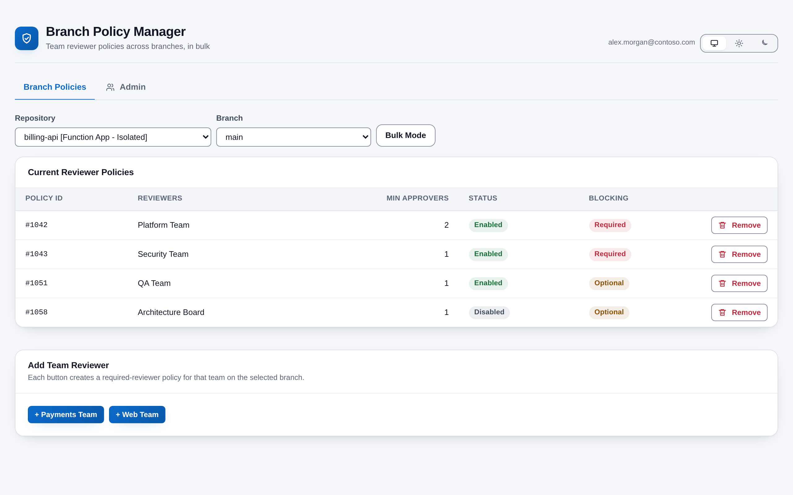
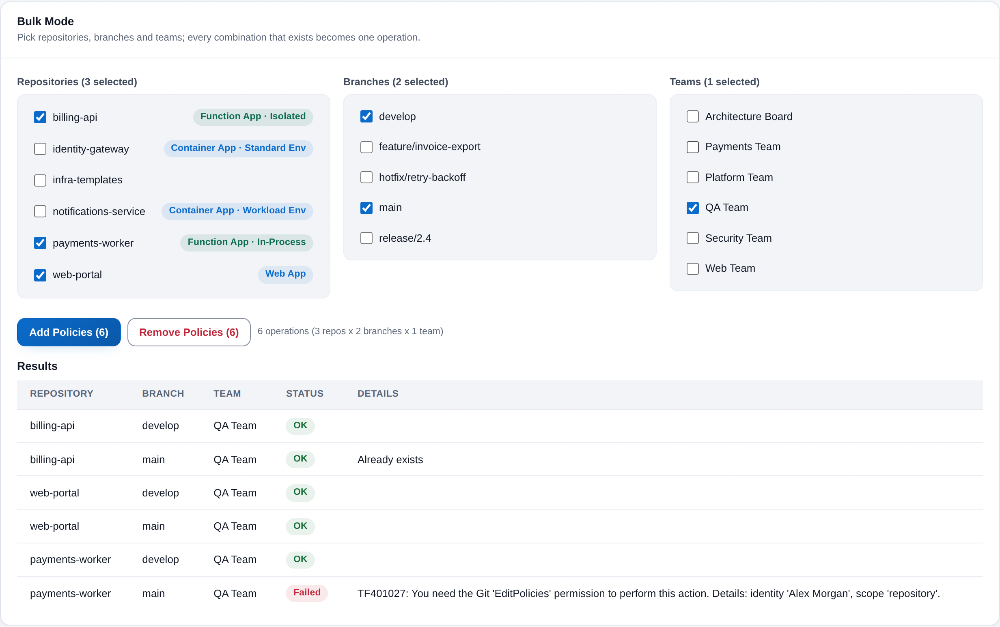

# Branch Policy Manager

Add and remove **team reviewer approval policies** on branches across your Azure DevOps project, one branch at a time or in bulk across many repositories, branches and teams at once. Branch Policy Manager is built for the people who look after branch protection (repository admins, platform and security teams) and answers one question: *which teams must approve pull requests into this branch, and how do I change that everywhere in one go?* It lives under **Repos > Branch Policies** and runs entirely in your browser.

## Features

- **Team approval management** - Add or remove a required team reviewer policy on any branch (for example `develop` or `main`) from a single screen, with the current policies, their minimum approver count and whether they are enabled and blocking shown in one table.
- **Bulk operations** - Pick any combination of repositories, branches and teams; every combination that exists becomes one operation. A progress bar tracks the batch and a results table reports each operation as OK or Failed with the reason.
- **Duplicate-safe** - Bulk add skips combinations that already have a matching policy, and bulk remove reports when there was nothing to remove, so re-running a batch is harmless.
- **Admin access control** - Only authorized users can open the extension. The first person to open it becomes the first admin; after that, admins grant and revoke access by email from the Admin tab, and the last remaining admin can never be removed.
- **Confirmation before every change** - Every removal and every bulk action is confirmed in an accessible dialog before anything is sent.
- **Repository badges** - Repositories are labelled Function App (Isolated or In-Process), Container App (Standard or Workload environment) or Web App, so you can pick the right ones in bulk mode at a glance.
- **Follows your Azure DevOps theme** - Light, dark and high-contrast themes are picked up automatically, with a manual light/dark override in the header. Colours meet WCAG AA contrast.

## How it works

1. Open **Repos > Branch Policies** in any project. The extension checks you against its authorized-user list; on the very first open, you are recorded as the first admin and told so.
2. Pick a repository and a branch to see every required-reviewer policy that covers it, or switch to **Bulk Mode** and tick repositories, branches and teams.
3. Add a team with one click, or remove a policy after confirming. In bulk mode, confirm the operation count and watch the results table fill in.
4. Use the **Admin** tab to grant colleagues access by their Azure DevOps sign-in email.

## Permissions

The extension asks for these scopes when it is installed:

- **Code (manage)** - To read, create and delete branch policy configurations, and to read repository contents for the badges.
- **Project** - To find the current project and list its repositories, branches and teams.

Everything stays inside the Azure DevOps organization the extension is installed in.

## Privacy

Everything runs inside the Azure DevOps web UI against your organization's own REST API. No telemetry is collected and nothing is sent to any third party. The only data the extension stores is the authorized-user email list, kept in the Azure DevOps Extension Data Service for your organization, plus your theme choice in your own browser.

## Support

Bug reports and feature requests are welcome through GitHub Issues: <https://github.com/adam-wheater/azure-devops-branch-policy-manager/issues>

## License

Copyright © 2026 Adam Wheater. All rights reserved. This software is provided under a proprietary source-available license: you may read and audit the code and use the published extension, but you may not copy, modify, redistribute or republish it. See the LICENSE file for the full terms. The open source components it bundles keep their own licenses, listed in THIRD-PARTY-NOTICES.txt inside the package.
